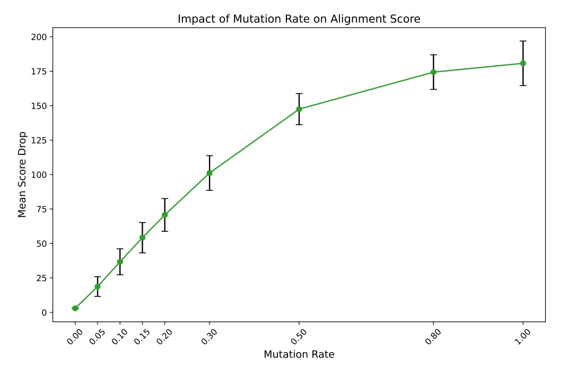

<div align="center">
 
🧬 DNA-Align — GPU-Accelerated Smith–Waterman
 
**Benchmarking serial CPU, multiprocessing CPU and CUDA GPU on real human DNA**
 


 
*Antonio Nikoloski · Skopje, North Macedonia*
 
</div>
 
## Overview
 
DNA-Align implements the **Smith–Waterman local alignment** algorithm three ways and measures how each one scales:
 
| Implementation | How it runs |
|---|---|
| **CPU serial** | One process, one alignment at a time |
| **CPU parallel** | Alignments spread over CPU processes (`multiprocessing`) |
| **CUDA GPU** | One GPU thread per alignment (`sw_kernel.cu`, via CuPy) |
 
Windows are sampled from the **GRCh38 chromosome 1** reference, and a mutated query is generated for each one with a configurable mutation rate and transition bias (A↔G, C↔T). Every reference–query pair is then aligned, and runtimes and alignment scores are compared.
 
## How it works
 
```
FASTA ─▶ encode A/C/G/T ─▶ sample windows ─▶ inject mutations ─▶ align (CPU / GPU) ─▶ compare scores & time
```
 
Scoring is **match +2, mismatch −1, gap −1**. The cost per alignment grows quadratically with sequence length *L*. The GPU kernel runs one independent alignment per thread and keeps two dynamic-programming rows in thread-local arrays, which limits it to **L ≤ 1024**.
 
| File | Role |
|---|---|
| `main.py` | Data loading, mutation generation, CPU/GPU benchmarks, plots |
| `sw_kernel.cu` | CUDA Smith–Waterman kernel |
| `environment.yml` | Conda environment (`cuda_genome`) |
 
## Getting started
 
**Requirements:** Conda and an NVIDIA GPU with a working CUDA driver.
 
```bash
git clone https://github.com/AntonioNDev/PiDP-Project.git
cd PiDP-Project
conda env create -f environment.yml
conda activate cuda_genome
```
 
Check that CuPy sees your GPU:
 
```bash
python -c "import cupy as cp; print(cp.cuda.runtime.getDeviceCount(), 'GPU(s)')"
```
 
**Reference genome:** [Homo sapiens chromosome 1, GRCh38 (CM000663.2)](https://www.ncbi.nlm.nih.gov/nuccore/CM000663.2/), 248,956,422 bases. It is not stored in the repo, so download it first:
 
```bash
curl -L "https://eutils.ncbi.nlm.nih.gov/entrez/eutils/efetch.fcgi?db=nuccore&id=CM000663.2&rettype=fasta&retmode=text" -o sequence.fasta
```
 
<details>
<summary>Windows PowerShell</summary>
```powershell
Invoke-WebRequest -Uri "https://eutils.ncbi.nlm.nih.gov/entrez/eutils/efetch.fcgi?db=nuccore&id=CM000663.2&rettype=fasta&retmode=text" -OutFile "sequence.fasta"
```
 
</details>
**Run the benchmark:**
 
```bash
python main.py sequence.fasta
```
 
## Results
 
Sequence length **L = 128**, mutation rate 0.10, seed 42, best of 5 repeats per size. GPU timings include allocation and host↔device transfers.
 
| Alignments (N) | CPU serial (s) | CPU parallel (s) | GPU (s) | GPU vs serial | GPU vs parallel |
|---:|---:|---:|---:|---:|---:|
| 500 | 20.7 | 13.1 | 0.0047 | 4,397× | 2,788× |
| 1,000 | 41.5 | 19.0 | 0.0096 | 4,303× | 1,975× |
| 2,000 | 83.5 | 31.1 | 0.0234 | 3,567× | 1,329× |
| 3,000 | 124.3 | 44.0 | 0.0347 | 3,582× | 1,266× |
| 4,000 | 165.7 | 54.7 | 0.0472 | 3,512× | 1,160× |
| 5,000 | 207.7 | 66.8 | 0.0585 | 3,549× | 1,142× |
| 6,000 | 249.4 | 80.0 | 0.0679 | 3,672× | 1,178× |
 
- **Serial CPU time is linear in N** (≈ 41.6 s per 1,000 alignments) and quadratic in L.
- **GPU throughput levels off at roughly 85,000 alignments/s**; GPU time keeps growing with N.
- **The parallel CPU run pays a fixed start-up cost of about 7 s** per call, so its speedup over serial is only about 3.4× at large N.
**Correctness checks:** CPU and GPU scores matched on 64 pairs (0 mismatches), and sequence lengths 1, 128 and 1,024 passed. The observed mutation rate was 9.93% for a 10% target, and the transition fraction was 69.7% for a 70% target.
 

 
*Mean alignment-score drop as the mutation rate increases.*
 
## Limitations
 
- Mutations are simulated substitutions (no insertions or deletions), and the transition bias is a model parameter, not evidence of cancer-specific behaviour.
- Alignment scores measure sequence similarity and cannot tell whether a mutation is pathogenic.
- The kernel supports L ≤ 1024, and results depend on the GPU, CPU core count and driver.

## Roadmap
 
- Cleaner GPU timing (a warm-up call before each timed size)
- A reusable process pool for the CPU-parallel baseline
- Shared-memory and register-level kernel optimisation
- Automated CPU/GPU parity tests
---
 
<div align="center">
**Antonio Nikoloski** · [GitHub](https://github.com/AntonioNDev) · [PiDP-Project](https://github.com/AntonioNDev/PiDP-Project)
 
</div>
